# Blue forest plots

Nine primary outcomes, followed by four labelled sensitivity analyses. Download individual PNGs using the links below.

## 6-minute walk distance

[Download PNG](output/01_walk.png)

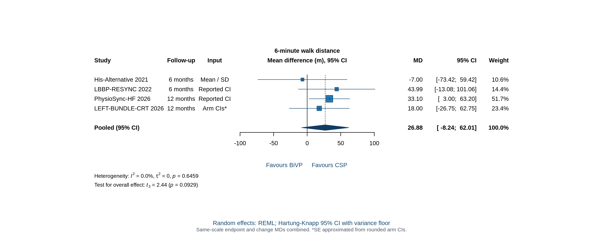

## NYHA functional class

[Download PNG](output/02_nyha.png)

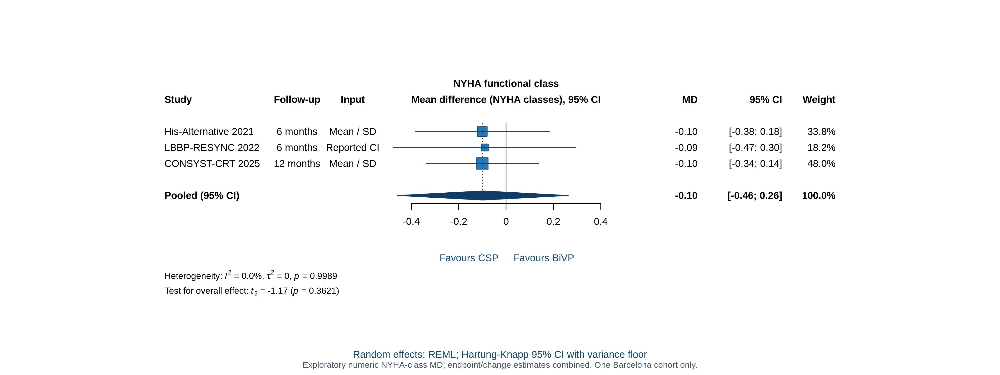

## Quality of life: EQ-5D utility

[Download PNG](output/03_qol.png)

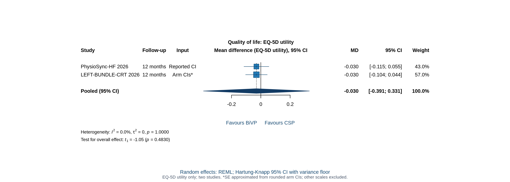

## QRS duration

[Download PNG](output/04_qrs.png)

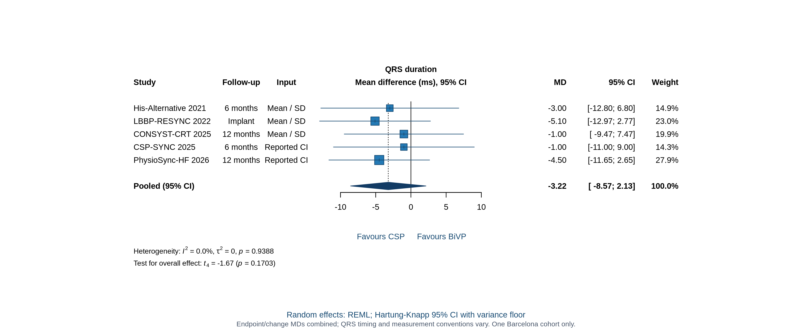

## Left ventricular ejection fraction

[Download PNG](output/05_lvef.png)

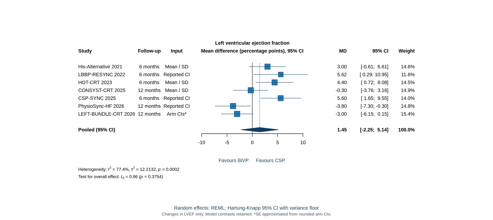

## Pacing threshold: exploratory voltage comparison

[Download PNG](output/06_threshold.png)

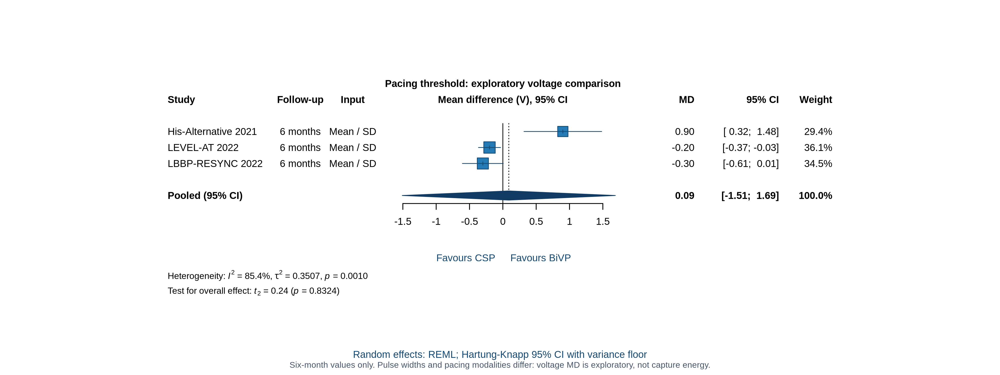

## All-cause death or HF hospitalization

[Download PNG](output/07_composite.png)

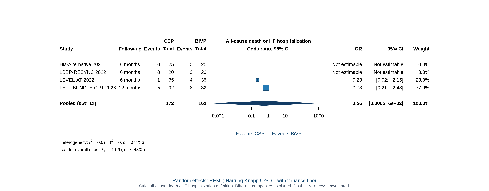

## Heart-failure hospitalization

[Download PNG](output/08_hhf.png)

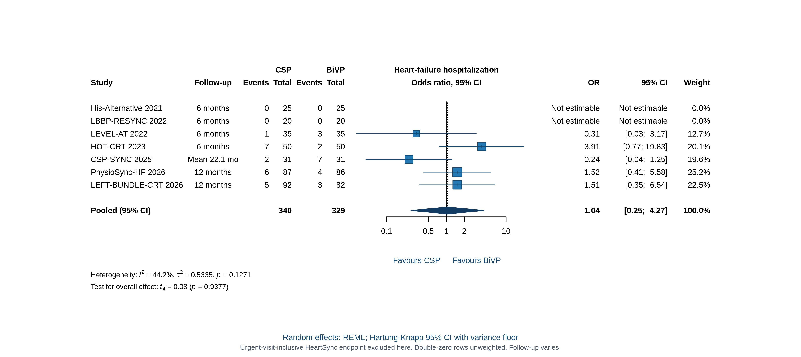

## All-cause mortality

[Download PNG](output/09_mortality.png)

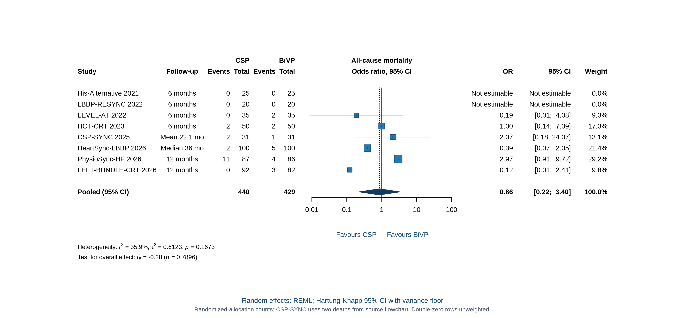

## Death or HF events, including urgent visits

[Download PNG](output/10_composite_broad.png)

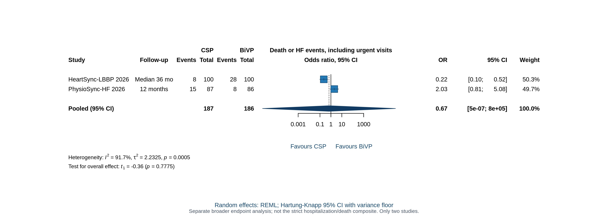

## HF hospitalization / urgent visits: sensitivity

[Download PNG](output/11_hhf_broad.png)

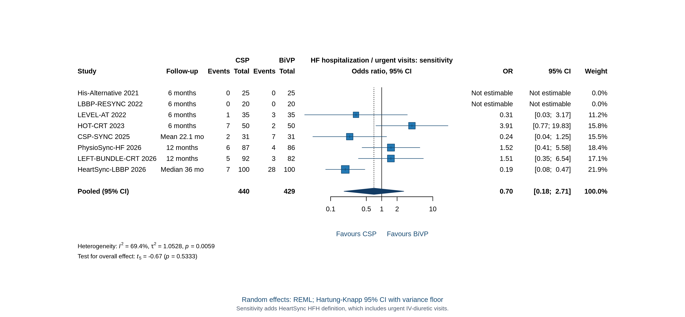

## All-cause mortality: as-treated sensitivity

[Download PNG](output/12_mortality_as_treated.png)

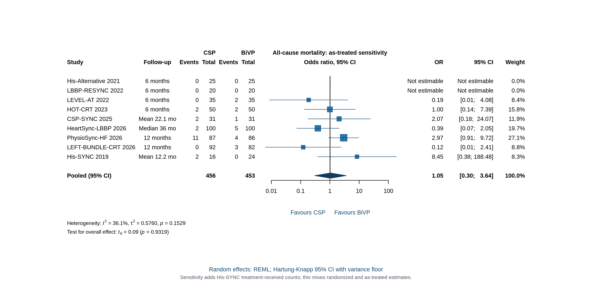

## QRS duration: as-treated sensitivity

[Download PNG](output/13_qrs_as_treated.png)

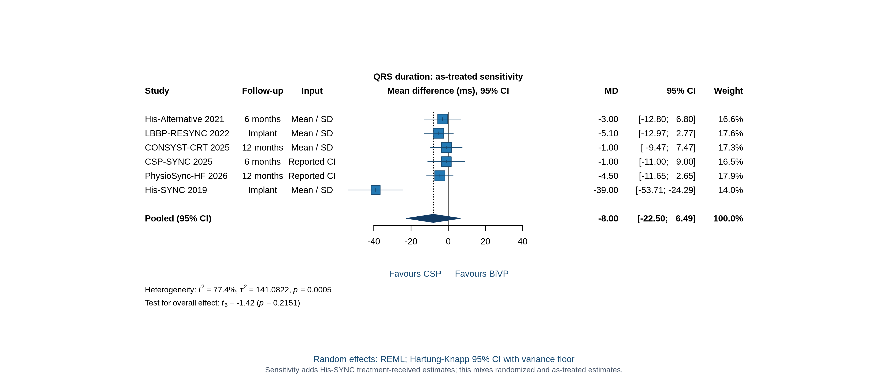
